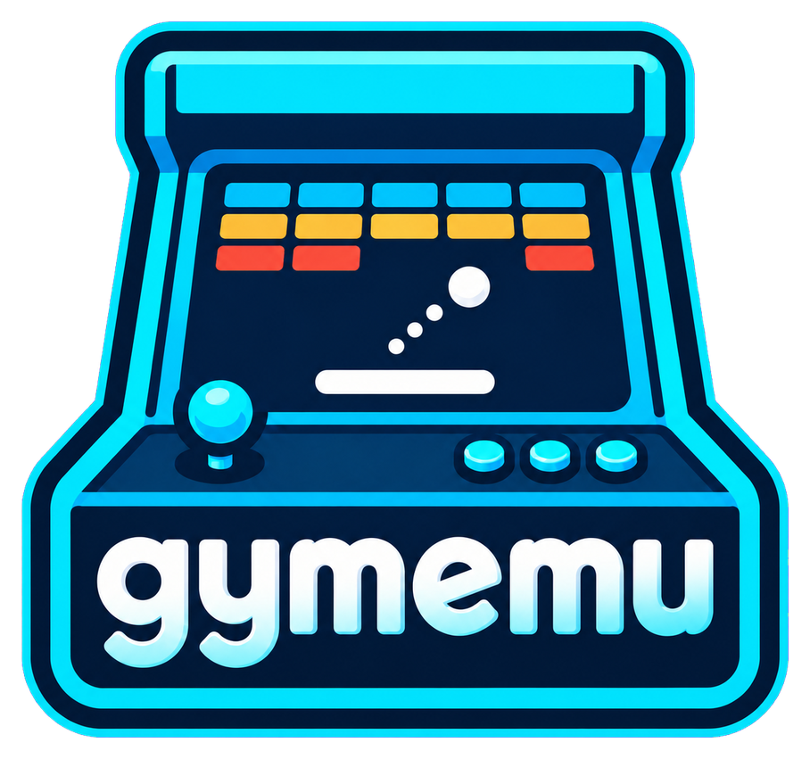

<p align="center">
  
  <br />
  <!-- repo-tagline:start -->
  <strong>🎮 Train on recordings, play the predictions 🧠</strong>
  <!-- repo-tagline:end -->
</p>

<p align="center">
  <a href="https://github.com/tsilva/gymemu/blob/main/pyproject.toml"></a>
  <a href="https://github.com/tsilva/gymemu/blob/main/LICENSE"></a>
</p>

Gymemu trains and compares learned game emulators from recorded frames and
actions. Play predictions from a checkpoint, inspect the reference frames, or
compare direct pixel models with staged latent pipelines.

## Quickstart

From a checkout with uv and Python 3.11–3.13, follow the [source installation
steps](docs/gymemu-guide.md#install). To browse existing runs and checkpoints:

```bash
uv run gymemu play
```

Select a checkpoint to open the Player. Use **Diagnostics** to inspect the run,
or pass `--no-browser` to print the local URLs.

- [Training and publication](https://github.com/tsilva/gymemu/blob/main/docs/training.md)
- [Experiment history](https://github.com/tsilva/gymemu/blob/main/docs/history.md), [recipes](https://github.com/tsilva/gymemu/blob/main/docs/recipes.md), and
  [comparison metrics](https://github.com/tsilva/gymemu/blob/main/docs/metrics.md)

[Read the gymemu player and training reference](https://github.com/tsilva/gymemu/blob/main/docs/gymemu-guide.md) for the full reference.

## License

[MIT License](https://github.com/tsilva/gymemu/blob/main/LICENSE).
